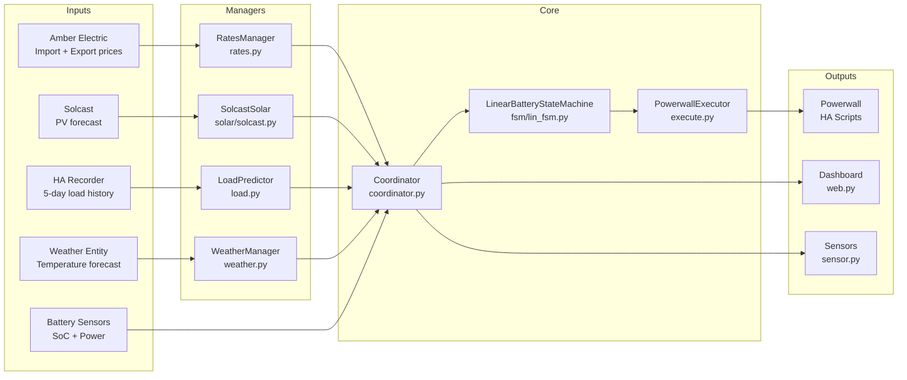

# How It Works

This document explains the full data pipeline of House Battery Control — from raw sensor data to Powerwall commands. It covers every input, every output, and what each component does with the data.

The solver's mathematical formulation (linear programming) is intentionally omitted. Instead, this document explains *what the solver tries to achieve* and *what rules it follows*.

---

## The 5-Minute Cycle

HBC operates on a 5-minute cadence, aligned with Amber Electric's pricing intervals:

```
Every 5 minutes:
  1. Collect  → Read all sensor values + forecasts
  2. Predict  → Build 24-hour load forecast from history
  3. Solve    → Calculate optimal battery schedule
  4. Execute  → Send command to Powerwall (if state changed)
  5. Report   → Update dashboard + sensors + API
```

The coordinator listens for state changes on vital telemetry and tariff price entities (triggering immediate re-evaluation when Amber Express publishes a new 5-minute settlement price) and aligns a guaranteed settlement clock tick at `:00:15, :05:15, ..., :55:15`.

---

## Data Pipeline



---

## Inputs (Detailed)

### 1. Tariff Rates

**Source**: Amber Electric integration sensors  
**Manager**: `RatesManager` (`rates.py`)  
**Sample rate**: 5-minute intervals (chunked from Amber's 30-min or variable intervals)  
**Horizon**: 24 hours (~288 intervals)

The `RatesManager` reads from two HA sensor entities:
- **Import price sensor** — `forecast` attribute containing future buy prices
- **Export price sensor** — `forecast` attribute containing future sell/feed-in prices

Additionally, the `Coordinator` itself explicitly overrides the immediate `t=0` calculations if **Current Import Price Entity** or **Current Export Price Entity** are configured. This guarantees the FSM responds to instantaneous price spikes (like Amber's 5-minute pre-dispatch) without waiting for the 30-minute forecast array to align.

Each interval is parsed into a `RateInterval`:

```
RateInterval {
    start:        datetime     # Interval start (UTC, timezone-aware)
    end:          datetime     # Interval end (UTC, timezone-aware)
    import_price: float        # Buy price in c/kWh
    export_price: float        # Sell price in c/kWh
    type:         str          # "ACTUAL" or "FORECAST"
}
```

Amber publishes prices in 30-minute blocks. RatesManager **chunks these into 5-minute ticks** so every rate interval matches the solver's resolution. Import and export rates are **merged by start time** into a single timeline.

#### Amber Express Pricing

If the `Use Amber Express format` configuration toggle is enabled, `RatesManager` uses a specialised parser that extracts Amber's embedded 24-hour forecast array directly from the primary import/export sensors.

Because Amber Express provides a range of potential prices (`predicted` and `high`), the system uses a **renewables-based dynamic price blend** to protect the solver from sudden grid-stress price spikes:

- If grid renewables are **≥ 35.0%**: The FSM uses 100% of the `predicted` price.
- If grid renewables are **≤ 25.0%**: The FSM uses 100% of the `high` price.
- If renewables fall in the **10% band between 25% and 35%**: The price scales linearly. For example, at 30% renewables, the FSM uses exactly 50% of the predicted price plus 50% of the high price.

This interpolation ensures the solver plans defensively as grid stress increases and dispatch risks rise.

### 2. Solar Forecast

**Source**: Solcast HACS integration  
**Manager**: `SolcastSolar` (`solar/solcast.py`)  
**Sample rate**: Variable (typically 30-minute), interpolated to 5-minute  
**Horizon**: 24–48 hours

The Solcast sensors provide `forecast` attributes with predicted PV generation. Each interval:

```
Solar Interval {
    start: str (ISO 8601)    # Interval start
    kw:    float             # Predicted solar production in kW
}
```

### 3. Load Forecast

**Source**: HA Recorder (5-day history of configured load/energy sensor)  
**Manager**: `LoadPredictor` (`load.py`)  
**Sample rate**: 5-minute intervals  
**Horizon**: 24 hours (288 intervals)

LoadPredictor builds a statistical profile from your actual usage history:

1. Fetches 5 days of history from the HA recorder for the configured load entity
2. Fetches 5 days of temperature history from the configured `weather_entity` (`attributes.temperature`)
3. Passes both through `historical_analyzer.py` to build an average profile per 5-minute time slot, containing both load (kW) and average temperature (°C)
4. Handles both **power sensors** (kW, used directly) and **energy sensors** (kWh, converted via `kW = delta_kWh × 12`)
5. Applies **excess-based temperature adjustments**: compares how much historical HVAC load was driven by temperature versus how much will be needed today

#### Temperature Adjustment Formula

```
# Cooling (above high_threshold):
excess_hist = max(0, historical_avg_temp - high_threshold)
excess_forecast = max(0, forecast_temp - high_threshold)
cooling_adj = (excess_forecast - excess_hist) × high_sensitivity

# Heating (below low_threshold):
excess_hist = max(0, low_threshold - historical_avg_temp)
excess_forecast = max(0, low_threshold - forecast_temp)
heating_adj = (excess_forecast - excess_hist) × low_sensitivity

adjustment = cooling_adj + heating_adj
```

This ensures that if history included aircon load (e.g. 30°C) but today is mild (22°C), the prediction is **reduced**. Conversely, if today is hotter than history, load is **increased**.

If no temperature history is available, the system falls back to absolute threshold behaviour (applying `sensitivity × degrees_beyond_threshold`).

Each interval:

```
Load Interval {
    start:              str (ISO 8601)  # Interval start
    kw:                 float           # Predicted household load in kW (dynamically scaled)
    temp_delta:         float | null    # Forecast temp minus historical avg temp (°C)
    load_adjustment_kw: float           # kW adjustment applied due to temperature
}
```

### 4. Weather Forecast

**Source**: Any HA weather entity  
**Manager**: `WeatherManager` (`weather.py`)  
**Sample rate**: Hourly  
**Horizon**: 24+ hours

Provides temperature data used by the LoadPredictor for temperature-adjusted load forecasts:

```
Weather Interval {
    datetime:    datetime    # Forecast time
    temperature: float      # Predicted temperature in °C
    condition:   str        # "sunny", "cloudy", "rainy", etc.
}
```

### 5. Battery State (Real-Time)

**Source**: Battery sensors configured in Step 1  
**Read by**: Coordinator directly via `_get_sensor_value()`

| Field | Source Entity | Unit | Notes |
|---|---|---|---|
| `soc` | `battery_soc_entity` | % | Current charge level (0–100) |
| `battery_power` | `battery_power_entity` | kW | Positive = discharging (or inverted) |
| `solar_production` | `solar_entity` | kW | Current PV output |
| `grid_power` | `grid_entity` | kW | Positive = importing (or inverted) |
| `current_price` | `import_price_entity` | c/kWh | Current import (buy) spot price |
| `current_export_price` | `export_price_entity` | c/kWh | Current export (sell) spot price |

### 6. Battery Configuration

**Source**: Config flow settings (Step 2)

| Field | Key | Unit | Default |
|---|---|---|---|
| Capacity | `battery_capacity` | kWh | 27.0 |
| Max charge/discharge rate | `battery_rate_max` | kW | 6.3 |
| Inverter limit | `inverter_limit` | kW | 10.0 |
| Reserve SoC floor | `reserve_soc` | % | 0.0 |
| No-Import Periods | `no_import_periods` | String | "" |

These are used to construct a `FakeBattery` model that the solver uses to simulate battery behaviour over the 24-hour horizon.

---

## The FSM Context (Solver Input)

All inputs are assembled by the Coordinator into an `FSMContext` dataclass — the single input to the solver:

```python
@dataclass
class FSMContext:
    soc: float              # Current battery % (0–100)
    solar_production: float # Current PV output (kW)
    load_power: float       # Current house load (kW)
    grid_voltage: float     # Grid voltage (V) — optional
    current_price: float    # Current import price (c/kWh)
    forecast_solar: list    # 288 × {start, kw}
    forecast_load: list     # 288 × {start, kw}
    forecast_price: list    # 288 × RateInterval
    config: dict            # Battery specs + all config keys
    acquisition_cost: float # Weighted average cost of stored energy (c/kWh)
    current_export_price: float  # Current export (sell) price (c/kWh)
```

---

## Financial Tracking & Persistence

HBC tracks the financial performance of your battery using two key metrics that persist across Home Assistant restarts:

1. **Cumulative Cost ($)**: The running total of money spent (or earned, if negative) since the integration was first installed. This is calculated internally by analyzing the actual grid interactions (import/export) during each 5-minute interval.
2. **Acquisition Cost (c/kWh)**: The blended average cost of the energy currently sitting in your battery. 

### Dynamic Acquisition Cost Calculation
The system calculates the true cost of stored energy rather than just using a static figure. Every 5 minutes, if the battery is actively charging, HBC calculates the cost of the raw energy entering the battery:
- **Grid Charging**: Valued at the current Amber import price.
- **Solar Charging**: Valued at the *opportunity cost* (what you could have earned if you exported that solar to the Amber grid instead).

This incoming energy cost is then mathematically blended (weighted average) against the existing energy in the battery to update the `acquisition_cost`. This dynamic acquisition cost is used by the solver's **row-by-row gate** in the sequence builder (see below) to prevent the battery from exporting energy for less than it cost to acquire at each step in the forecast.

### Persistence Mechanism
Both `cumulative_cost` and `acquisition_cost` are securely written to Home Assistant's internal `Store` API (`.storage/house_battery_control.cost_data`). The integration utilizes delayed JSON writes to buffer I/O operations, ensuring data survives system reboots and updates without degrading Home Assistant's performance.

---

## What the Solver Does

The solver (`LinearBatteryController` in `fsm/lin_fsm.py`) takes the `FSMContext` and calculates the mathematically optimal battery schedule. Here's what it tries to achieve and what rules it follows:

### Objective

**Minimise total daily electricity cost.**

This means: minimise the total amount you pay for imported grid power, minus the revenue from exported power, across all 288 five-minute intervals in the next 24 hours.

### Decision Variables

For each 5-minute interval, the solver chooses:

| Variable | What it controls | Bounds |
|---|---|---|
| Grid import | How much to buy from the grid | ≥ 0 kW |
| Grid export | How much to sell to the grid | ≥ 0 kW |
| Battery charge | How much to charge the battery | ≥ 0 kW, ≤ charge rate limit |
| Battery discharge | How much to discharge the battery | ≥ 0 kW, ≤ discharge rate limit |

### Constraints (Rules the Solver Must Follow)

1. **Energy balance**: At every interval, energy in = energy out. Grid import + solar + battery discharge = house load + grid export + battery charge.
2. **SoC bounds**: Battery state of charge must stay between `reserve_soc` and 100% at all times.
3. **Rate limits**: Charge and discharge power cannot exceed `battery_rate_max`.
4. **Capacity**: Total stored energy cannot exceed `battery_capacity`.
5. **Efficiency losses**: Charging and discharging have configurable round-trip efficiency (default 90%, set via `round_trip_efficiency`). The solver uses √(RTE) for each one-way conversion.
6. **Reserve floor**: SoC must not drop below the configured `reserve_soc` at any interval.
7. **No-Import Periods**: Grid import is bounded to strictly `0.0 kW` during user-defined textual time spans (e.g. `15:00-21:00`), bypassing arbitrage logic.

### What the Solver Does NOT Do

- **It does not predict prices** — it consumes Amber's published forward prices
- **It does not learn from past behaviour** — each solve is independent
- **It does not control individual battery cells** — it sets high-level modes
- **It does not account for grid outages** — it assumes continuous grid availability

---

### Price Forecast Reliability

Amber Electric's forward prices are *forecasts* — they can change significantly between prediction time and the actual dispatch interval. A naive solver that blindly trusts a predicted afternoon price spike may hoard energy for a surge that never eventuates, missing earlier opportunities.

HBC addresses this through several mechanisms:

#### Current Defences

1. **Re-solve on every entity change**  
   The coordinator listens for state changes on price and other telemetry entities. When Amber revises a forecast, the solver re-runs immediately with the updated prices rather than waiting for the next 5-minute cycle. This means the plan automatically adapts as forecasts firm up closer to real-time.

2. **Row-by-row acquisition cost gate**  
   After solving, the sequence builder evaluates each step's profitability **individually**. At each step `i`, the projected acquisition cost (computed from prior charging/discharging) is compared against the export price. If the export price is below the acquisition cost at that step, the discharge-to-grid decision is overridden to SELF_CONSUMPTION and the battery retains the energy — with full SoC propagation to all subsequent steps. This prevents the grid-drain scenario where a predicted high feed-in price collapses at settlement. The battery values its stored energy at what it cost to charge — if selling isn't profitable at any given step, it holds.

3. **Terminal valuation**  
   Energy remaining in the battery at the end of the 24-hour window is valued at a blended rate between the median buy price and the acquisition cost. This discourages the solver from planning to "run the battery to zero" on speculative future prices.

#### Planned Improvements

The quality of input data — not the solver itself — is the primary challenge. The following approaches are under active consideration:

- **Historical price blending**: Median the last 5 days of actual settled prices as a forecast, blended with Amber's live forecast. This would dampen false spikes while still responding to genuine price events.
- **Spike dampening**: Discount or overwrite predicted spikes (e.g. > $1/kWh) with the average of surrounding non-spike prices, since extreme forecasts are disproportionately unreliable.
- **Forecast confidence weighting**: Place more weight on the Amber forecast when a spike is predicted (since genuine events *do* occur), but temper it with historical data to reduce exposure to false signals.
- **AEMO data source**: Use AEMO's own dispatch data as an alternative or supplementary price signal, which tends to be more conservative than Amber's retail forecasts.

> **Note**: These are the same challenges faced by other home battery optimisers (e.g. Predbat). The input data quality problem is solver-agnostic — any linear or dynamic programming solver consuming the same unreliable forecast will exhibit the same false-spike chasing behaviour.

---

## Outputs (Detailed)

### FSMResult

The solver returns an `FSMResult` — the single output that drives everything:

```python
@dataclass
class FSMResult:
    state: str                              # FSM state name (e.g., "CHARGE_GRID")
    limit_kw: float                         # Power limit for this state (kW)
    reason: str                             # Human-readable explanation
    target_soc: float | None                # Target SoC if applicable (%)
    projected_cost: float | None            # Projected 24h cost ($)
    future_plan: list[dict] | None          # 288-element plan array
```

### FSM States

| State | What It Means | Physical Powerwall Action |
|---|---|---|
| `SELF_CONSUMPTION` | Default state: battery supports home load autonomously | Self-Consumption, inverter auto-manages |
| `CHARGE_GRID` | Cheaper to buy now than buy later | Force charge from grid (Backup mode) |
| `DISCHARGE_GRID` | Export to grid for profit | Time-Based Control, export enabled |
| `ERROR` | Solver failed or returned invalid result | All actions stopped |

### Future Plan Array

The `future_plan` is an array of 288 dictionaries, one per 5-minute interval, representing the full optimal schedule:

```
Plan Interval {
    target_soc:        float  # Projected SoC at interval end (%)
    state:             str    # FSM state for this interval
    net_grid:          float  # Net grid power (kW, positive=import)
    load:              float  # Forecasted load (kW)
    pv:                float  # Forecasted solar (kW)
    import_price:      float  # c/kWh
    export_price:      float  # c/kWh
    acquisition_cost:  float  # Per-step acquisition cost (c/kWh)
    cumulative_cost:   float  # Running cumulative cost ($)
}
```

---

## Execution

The `PowerwallExecutor` (`execute.py`) translates the FSM state into physical Powerwall commands via HA script calls.

### State → Script Mapping

| FSM State | Script Called | Powerwall Mode |
|---|---|---|
| `CHARGE_GRID` | `script_charge` | Backup mode, grid charging enabled |
| `DISCHARGE_GRID` | `script_discharge` | Time-Based Control, export enabled |
| `SELF_CONSUMPTION` | `script_charge_stop` or `script_discharge_stop` (transition-aware) | Self-Consumption, inverter manages autonomously |
| `ERROR` | Stop active script (transition-aware) | Safety stop |

### Deduplication & 5-Minute Settlement Keepalive

The executor tracks the last applied state and the discrete 5-minute NEM settlement slot (`:00, :05, ..., :55`).
- **Active states (`CHARGE_GRID`, `DISCHARGE_GRID`)**: Execute immediately on state entry and re-execute **once per new 5-minute settlement slot** so timed local Powerwall dispatches (e.g. `600s` duration) are continuously renewed without mid-session expiry, while all sub-interval telemetry refreshes and fractional `limit_kw` changes within the same 5-minute slot are suppressed.
- **Passive states (`SELF_CONSUMPTION`, `ERROR`)**: Remain strictly one-and-done—stop scripts are called once on state exit and never repeated across idle slots.
- **Direct reversals (`CHARGE_GRID ↔ DISCHARGE_GRID`)**: Await completion of the previous stop script (`blocking=True`, bounded by a `15s` timeout) before invoking the opposite start script.
